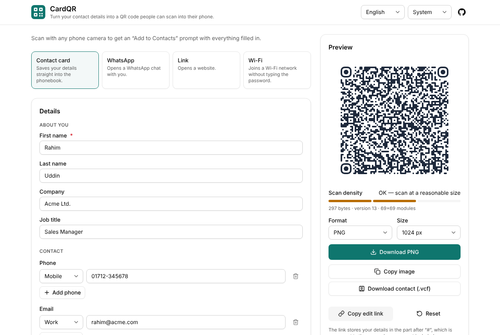
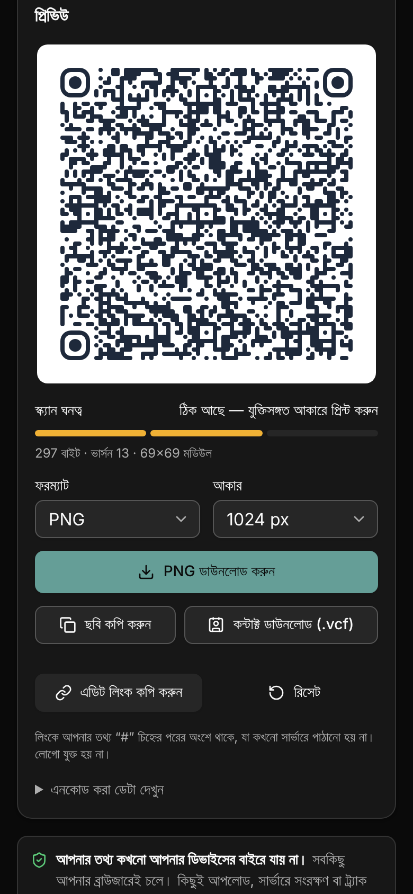

# CardQR — open-source vCard QR code generator

Turn your contact details into a QR code. Anyone who scans it with a phone camera gets an
**“Add to Contacts”** prompt with everything filled in, including a WhatsApp link.

Everything runs in your browser. **There is no backend, no database, no analytics, and no data
ever leaves your device.**

[](https://vercel.com/new/clone?repository-url=https%3A%2F%2Fgithub.com%2FceKapsys%2FbusinessCard-qr&project-name=cardqr&repository-name=cardqr)


| Desktop                                             | Mobile (Bangla, dark mode)                                    |
| --------------------------------------------------- | ------------------------------------------------------------- |
|  |  |

## Features

- **Contact card (vCard 3.0)** — name, company, title, multiple phones and emails with types,
  website, address, note and social profiles (LinkedIn, Facebook, Instagram, X).
- **WhatsApp-ready** — adds a tappable “WhatsApp” link to the contact and makes sure the number is
  saved as a mobile number, so the contact shows up in WhatsApp.
- **More QR types** — WhatsApp chat (`wa.me` with a pre-filled message), website link, and Wi-Fi
  login. New types are plug-ins (see [CONTRIBUTING.md](CONTRIBUTING.md)).
- **Phone numbers done right** — local numbers like `01712-345678` are normalised to E.164
  (`+8801712345678`) with libphonenumber-js. Invalid numbers show an error and are never encoded.
- **Bangla and other scripts** — UTF-8 all the way through, including inside the QR code.
- **Design it** — colours, linear gradient, dot and corner styles, margin, error correction, and
  your own logo (error correction is forced to High and the logo capped at about 20% of the width).
  Four built-in presets, plus your own saved presets.
- **Export** — PNG, JPEG (always on a solid background), SVG and WebP at 512, 1024 or 2048 px,
  copy to clipboard, and a `.vcf` contact file with exactly the same data.
- **Scannability check** — a scan-density meter (good / OK / risky) and warnings for low contrast
  or inverted colours.
- **Drafts and sharing** — your draft autosaves on this device. “Copy edit link” packs everything
  (except the logo) into the URL `#hash`.
- **English and Bangla UI**, light/dark mode, keyboard and screen-reader friendly.
- **Installable PWA** that works offline after the first visit.

## Privacy

- The app is a static site. There are no API routes, no server code, no database, no cookies,
  and no analytics or third-party scripts.
- Drafts, saved presets and your logo live in your browser’s `localStorage` only. “Reset” clears
  them.
- Logos are read with `FileReader` on your device and are never uploaded.
- Edit links keep the data in the URL **fragment** (`#s=…`). Browsers never send the fragment to
  the server, so your details don’t end up in hosting logs. Anyone you give the link to can read
  the details, so share it with care.
- A strict Content-Security-Policy (`vercel.json`) blocks requests to any other origin.

## How scanning works

The QR code contains plain text: a [vCard](https://datatracker.ietf.org/doc/html/rfc2426). Phone
cameras (iPhone Camera, Google Lens, Samsung Camera…) recognise `BEGIN:VCARD` and offer to create a
contact. A typical card looks like this:

```text
BEGIN:VCARD
VERSION:3.0
N;CHARSET=UTF-8:Uddin;Rahim;;;
FN;CHARSET=UTF-8:Rahim Uddin
ORG;CHARSET=UTF-8:Acme Ltd.
TEL;TYPE=CELL:+8801712345678
EMAIL;TYPE=INTERNET,WORK:rahim@acme.com
item1.URL:https://wa.me/8801712345678
item1.X-ABLabel:WhatsApp
END:VCARD
```

- Lines end with CRLF. Empty fields are left out, and `\ , ;` and newlines are escaped.
- There is no `PHOTO`: an embedded image would make the code far too dense to scan.
- Open **“Show encoded data”** under the preview to see the exact text in your code.

### Why WhatsApp needs two things

WhatsApp has no field of its own in a vCard. WhatsApp finds people by reading your **phonebook**:
any saved mobile number with a WhatsApp account shows up in WhatsApp automatically. So CardQR:

1. makes sure your WhatsApp number is in the card as `TEL;TYPE=CELL` (in international format, so
   it works for people abroad too), and
2. adds an `item1.URL:https://wa.me/<number>` link labelled **WhatsApp**. On iPhone and most
   Android phones it shows as a tappable “WhatsApp” entry that opens a chat directly.

If “WhatsApp is the same as my mobile number” is on, the first mobile number is used.

## Quick start

Requirements: Node.js 20+ and [pnpm](https://pnpm.io) (`corepack enable` will set it up).

```bash
pnpm install
pnpm dev            # http://localhost:3000
```

| Command          | What it does                                                    |
| ---------------- | --------------------------------------------------------------- |
| `pnpm dev`       | Development server                                              |
| `pnpm build`     | Static export to `out/` and generate the offline service worker |
| `pnpm preview`   | Serve `out/` locally (production build, offline mode works)     |
| `pnpm test`      | Unit and component tests (Vitest)                               |
| `pnpm lint`      | ESLint                                                          |
| `pnpm typecheck` | TypeScript                                                      |
| `pnpm format`    | Prettier                                                        |
| `pnpm icons`     | Regenerate the PNG app icons                                    |

### Test a scan on your phone

1. Put your computer and phone on the same Wi-Fi.
2. Run `pnpm dev --hostname 0.0.0.0`.
3. Find your computer’s LAN IP (`ipconfig getifaddr en0` on macOS, `hostname -I` on Linux,
   `ipconfig` on Windows) and open `http://<that-ip>:3000` on the phone. You can also simply scan
   the preview from your computer screen with the phone camera.
4. Download the PNG and try scanning it from another phone, or from a print-out.

Clipboard and installing the PWA need HTTPS (or `localhost`). Use a Vercel preview deployment to
test those on a phone.

## Deploy to Vercel

1. Click **Deploy with Vercel** above, or import the repository at
   [vercel.com/new](https://vercel.com/new).
2. Keep the defaults. Vercel detects Next.js and runs `pnpm build`. No environment variables are
   needed.
3. Set `siteUrl` in `src/site.config.ts` to your production URL (used for social-share images and
   the sitemap) and push.

Any static host works too: upload the `out/` folder and apply the headers in `vercel.json` there.
Vercel’s preview toolbar is blocked by the strict CSP. Relax `script-src` in `vercel.json` if you
want it.

## Rebrand / white-label

Edit **only** [`src/site.config.ts`](src/site.config.ts): app name, tagline, description, accent
colour, logo, GitHub URL, production URL and the default country for local phone numbers. To also
recolour the PWA icons, change `BRAND` in `scripts/generate-icons.mjs` and run `pnpm icons`.

## Tech stack

Next.js (App Router, `output: "export"`), TypeScript (strict), Tailwind CSS + shadcn/ui,
react-hook-form + Zod, Zustand, qr-code-styling, libphonenumber-js, lz-string, next-intl,
Vitest + Testing Library. `qrcode-generator` (already a dependency of qr-code-styling) is imported
directly to measure scan density.

```text
src/
  app/                  layout, page, manifest, OG image, robots, sitemap
  components/form/      DynamicForm, FieldRenderer, RepeatableField, AddressField
  components/qr/        QRPreview, DesignPanel, ExportMenu, DensityMeter, TypeSwitcher
  components/app/       App shell, header, providers, share/reset actions
  lib/fields/           FieldDef type, field configs per group, validation
  lib/encoders/         registry + vcard, whatsapp, url, wifi
  lib/design/           design types, presets, qr-code-styling options
  lib/qr/               density, contrast, UTF-8 helpers, rendering
  lib/phone.ts          E.164 normalisation
  lib/share.ts          lz-string #hash links
  store/                Zustand stores (form, design, ui)
  i18n/                 en.json, bn.json
  site.config.ts        branding
tests/                  Vitest tests
scripts/                icon + service-worker generators
```

## Contributing

PRs are welcome. [CONTRIBUTING.md](CONTRIBUTING.md) shows how to add a field or a whole new QR type
with a few lines of config. Please follow the [Code of Conduct](CODE_OF_CONDUCT.md).

## License

[MIT](LICENSE)
